  
  
  

I build **AI-assisted software delivery pipelines** for enterprise applications: demos that take a change from business requirement through impact analysis, code generation, tests, independent review and release, with humans at every gate. Most of it runs on a synthetic insurer, **MapleSure Insurance**, so everything is shareable and nothing is client data.

- **AMS S-series**: an application-maintenance-services walkthrough in seven scenarios, from incident triage (S1) to full-scale development and delivery (S7)
- **GitLab Duo custom agents** that answer from a cited, owned, dated application knowledge record
- **Insurance domain apps** for group benefits: claims APIs, sponsor portals, underwriting dashboards, in Python and Java Spring Boot
- **AI-native engineering practice**: every repo carries `CLAUDE.md` and `AGENTS.md` rules, offline test suites and synthetic data only
- On the side: small **e-commerce ventures in India**, run from one monorepo

### 🤖 AI-assisted delivery

| Project | What it does | Tech | Highlights |
|---------|--------------|------|------------|
| **[ams-s3-demo](https://github.com/AlanLands/ams-s3-demo)** | S3 Enhancement Delivery: a user story on a MapleSure group-benefits app moves through AI impact analysis → code generation → tests → docs → release notes | Python, Streamlit, FastAPI, Anthropic & OpenAI SDKs, Amazon Bedrock, ChromaDB, pytest, Playwright | Four processes, one launch script each Target apps register through a manifest, no code edit Synthetic data only Step-by-step demo guide and PDF |
| **[sixFold](https://github.com/Alanlands1/sixFold)** | AMS tabletop: six AI-driven scenarios (S1 to S6) covering incident triage, RCA, enhancement delivery, knowledge and onboarding, predictive ops and governance reporting | Python, Streamlit, FastAPI, Anthropic & OpenAI SDKs, scikit-learn, GitLab and ServiceNow clients | One module per scenario Seeded synthetic data generators Per-scenario run/reset scripts and presenter notes |

### 🏗️ Currently building (private)

| Project | What it does | Tech | Highlights |
|---------|--------------|------|------------|
| **AMS S7 Demo** | Full-scale development and delivery: intake → planning with G1 sign-off → design → architecture → delivery packs → build and test evidence → independent review → release | Python, LLM pipelines, pytest | Four run environments: simulation, demo, live, replay Test suite passes offline with no API key Nothing simulated ever presents as live AI |
| **AMS Control Center** | AI agents for application-support incidents: intake, data quality, triage, resolution briefs, closure quality and knowledge building | Architecture and agent-flow design | Design stage, documented before code |
| **MapleSure apps** | Claims API, SponsorConnect portal, group-underwriting dashboard, guided disability-claim submission for plan sponsors | Python, FastAPI, Java Spring Boot, GitHub Actions | Target applications for the AMS pipelines Synthetic data only |
| **Application Knowledge Record** | One cited, owned, dated record per application; a GitLab Duo custom agent answers from it | Python (stdlib only), YAML schemas, GitLab CI | Validation and staleness checks Runs before anyone has approved a `pip install` |

> _Learning projects, deep-learning notebooks and older web apps live on my other account: [github.com/Alanlands1](https://github.com/Alanlands1)_

**Tata Consultancy Services** · Kochi, India
- Application maintenance and delivery for enterprise applications
- Building AI-assisted SDLC demos and GitLab Duo custom agents

**B.Tech, Computer Science and Engineering**

Deep learning (diabetic retinopathy, dog breeds), Spring Boot and PHP projects: **[@Alanlands1](https://github.com/Alanlands1)**

**YouTube:** [youtube.com/c/Alanlands](https://www.youtube.com/c/Alanlands)
**Kaggle:** [kaggle.com/alanlands23](https://www.kaggle.com/alanlands23)
**GitHub:** [@AlanLands](https://github.com/AlanLands) · [@Alanlands1](https://github.com/Alanlands1)

---

